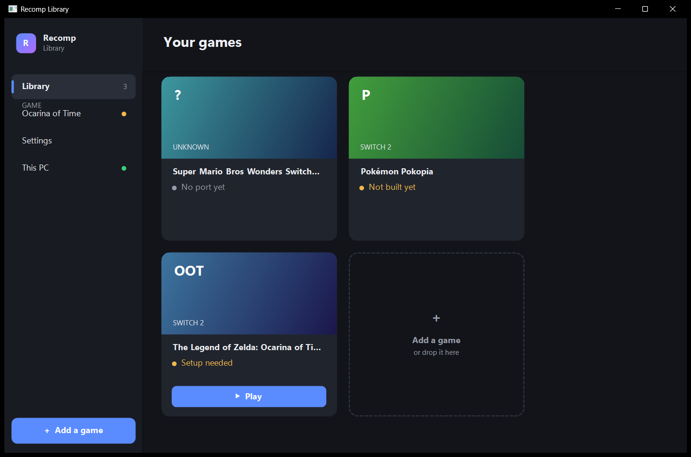
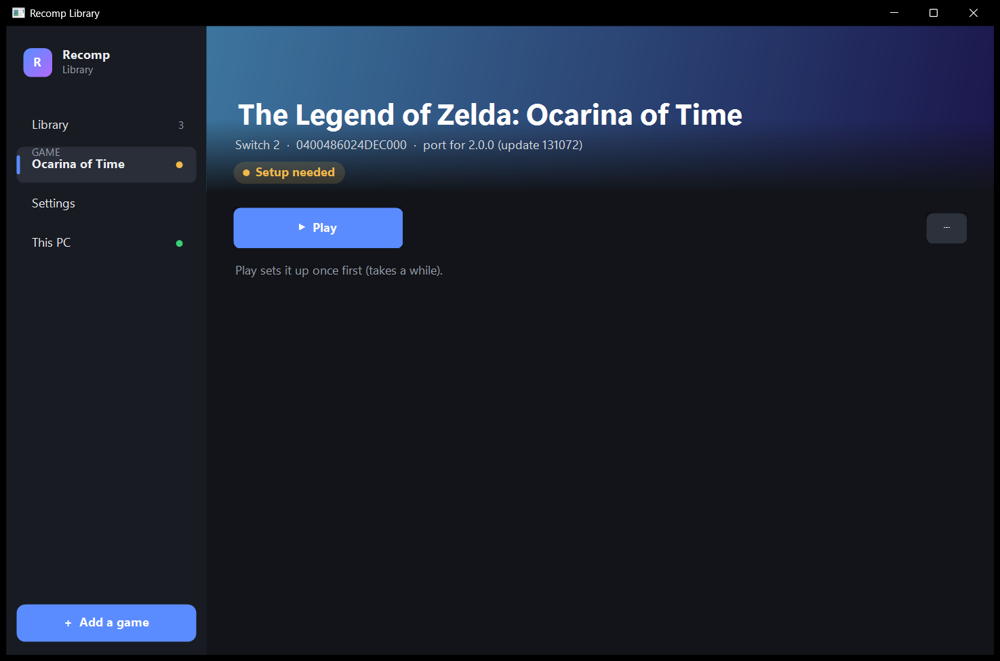
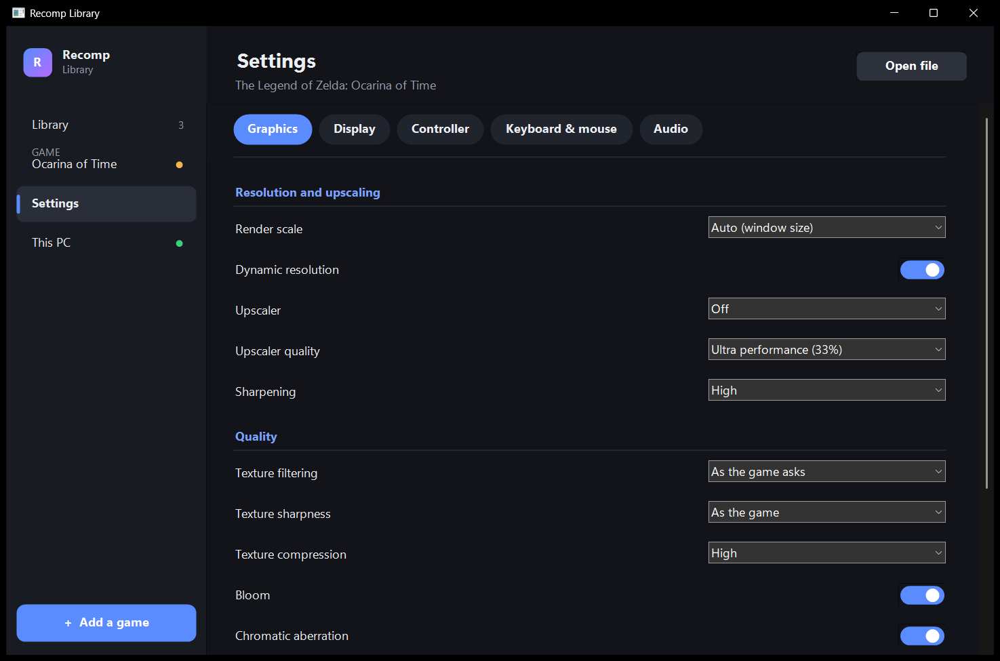
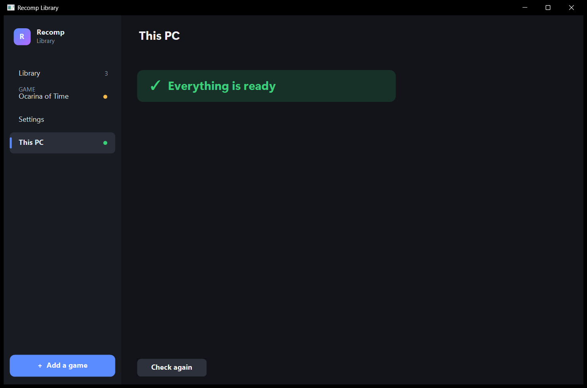

# Recomp Library

An unofficial app to play Nintendo Switch 2 games you own on Windows. It recompiles the game code from your own dump to PC code.
It contains no game files or keys, and it never downloads any.

## What it does

- **One app for every game.** Add a dump. The library recognises the game and shows it as a card.
- **Play.** The first press sets the game up once (extract, translate and compile the shaders for your graphics card), then starts it.
- **Settings for each game.** Graphics, display, controller, keyboard and mouse (press a key to bind it), and audio.
- **This PC.** Checks your PC and only tells you when something is missing.

| Game page | Settings | This PC |
|---|---|---|
|  |  |  |

## What you need

- Windows 10 (1809) or 11, 64-bit
- A graphics card with Vulkan 1.3 and a current driver
- 16 GB of RAM
- About 40 GB of free disk space per game
- Your own dump of the game, made from your console: a `.nup` file or an extracted folder (`exefs` + `romfs`)

## How to use it

1. Start `recomp_library.exe`.
2. Press **Add a game**, or drop your `.nup` file or game folder onto the window.
3. Press **Play**.

## Games

Which games and versions work, and how well: [GAMES.md](GAMES.md).

## Contributing

Bug reports, tests on other GPUs and code are welcome. Read [CONTRIBUTING.md](CONTRIBUTING.md) for the details. In short:

1. **Report bugs**: press **F9** in the game, then [open an issue](../../issues/new/choose) with the bundle, your GPU and the commit.
2. **Set up**: follow [DEVELOPMENT_SETUP.md](DEVELOPMENT_SETUP.md), then read [AGENTS.md](AGENTS.md) for the current state.
3. **Change**: branch from `oot-nup`, one fix per pull request, run the runtime tests, and say what you tested on which GPU.
4. **Never commit game files.**

| Part | Folder |
|---|---|
| Recompiler | `recomp/` |
| Runtime (shared by all games) | `runtime/` |
| Game-specific code | `recomp/games/<id>/`, `runtime/games/<id>/` |
| Library app | `runtime/apps/setup/` |
| Shader translator | `tools/shaders/` |

## Credits and licence

Built on [nxrecomp](https://github.com/drakolordx7/nxrecomp). Uses code from [Ryujinx](https://github.com/Ryubing/Ryujinx), [Mesa](https://gitlab.freedesktop.org/mesa/mesa), smo-recomp, ScarletNX, ssbu-recomp, SuperMarioWonderRecomp, Eden, libnx, [astc-encoder](https://github.com/ARM-software/astc-encoder), [bc7enc_rdo](https://github.com/richgel999/bc7enc_rdo), [libvpx](https://chromium.googlesource.com/webm/libvpx), [dav1d](https://code.videolan.org/videolan/dav1d), [Opus](https://opus-codec.org), AMD FidelityFX, NVIDIA Image Scaling, [SDL3](https://github.com/libsdl-org/SDL), [Zig](https://ziglang.org) and Python, plus [Kenney input prompts](https://kenney.nl/assets/input-prompts) and DejaVu fonts. Their licences are in `runtime/THIRD_PARTY_NOTICES.md`, `recomp/THIRD_PARTY.md`, `tools/shaders/licenses/` and `tools/textures/THIRD_PARTY.md`.

GPL-3.0. Third-party code keeps its own licence.

Not affiliated with or endorsed by Nintendo or any game publisher. Game names are trademarks of their owners and are used only to say
which games the app works with. See [LEGAL.md](LEGAL.md).
